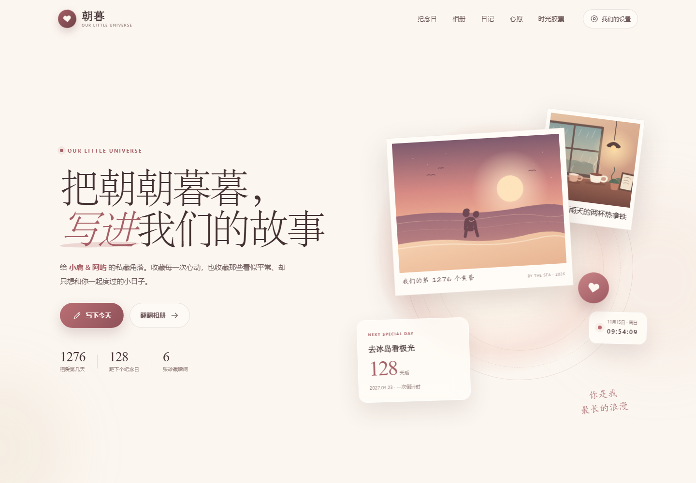
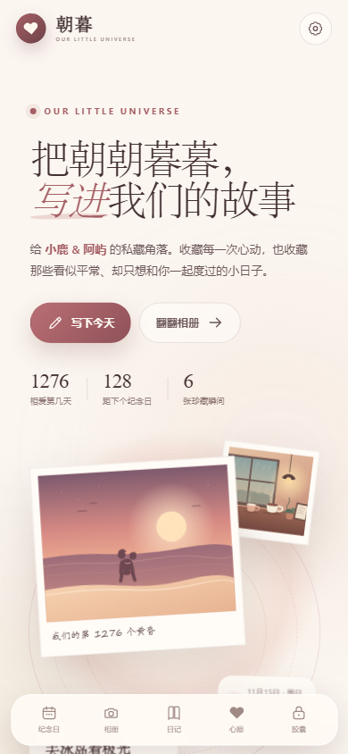

# 朝暮 · Our Little Universe

一个温暖、私密、零后端的情侣纪念网站。用纪念日、照片、日记、心愿清单和时光胶囊，把两个人的日常慢慢收藏起来。

> 所有内容仅保存在当前浏览器（IndexedDB + localStorage），不会上传到任何服务器。





## 功能

### 01 · 纪念日与倒计时
- 添加「每年纪念日」或「一次性倒计时」
- 自动计算已经相伴的天数、下一次纪念日、第几个年头
- 卡片支持编辑、删除，重要日子会同步显示在首页
- 可在设置中修改你们的起点日期

### 02 · 相册
- 点击或拖拽上传多张照片（JPG / PNG / WebP）
- 上传前自动压缩到最长边 1600px，节省本地空间
- 收藏、筛选「全部回忆 / 我的收藏」
- 灯箱浏览、上一张 / 下一张、编辑照片故事、删除
- 支持键盘方向键和 Esc

### 03 · 日记（Markdown / PDF）
- Markdown 写作，实时预览
- 工具栏快捷插入：加粗、斜体、标题、引用、列表、链接
- 导入 `.md` / `.markdown` / `.txt` 文件
- 导出 Markdown 文件
- 导出 PDF：打开排版好的打印页，在浏览器中选择「另存为 PDF」
- 可为日记添加 PDF 附件（最大 10MB），保存后随时打开
- 心情、天气、标签、搜索、编辑、删除

### 04 · 心愿清单
- 一起完成的小事清单
- 完成进度环、随机抽取一件今天去做
- 勾选完成、删除

### 05 · 时光胶囊
- 写一封给未来的信并设置开启日期
- 未到日期前无法拆开
- 到期后随时打开、重读、删除

### 其他
- 首页双人信息、在一起天数、实时时钟、下一件重要日子
- 每日心动签
- 桌面端 / 平板 / 手机响应式布局，移动端底部导航
- 首次打开预置少量示例内容，可在设置中一键清除
- 设置中支持清空全部内容

## 运行

无需安装依赖，推荐用本地静态服务器打开。

```bash
cd website
python -m http.server 8080
```

浏览器访问：`http://localhost:8080`

也可以直接双击 `index.html`。不过某些浏览器会限制 `file://` 下的 IndexedDB，届时照片和日记可能无法持久保存，所以更推荐本地服务器。

## 文件结构

```text
website/
├── index.html
├── README.md
└── assets/
    ├── css/
    │   └── style.css
    ├── js/
    │   └── app.js
    └── img/
        ├── memory-1.svg
        ├── memory-2.svg
        ├── memory-3.svg
        ├── memory-4.svg
        ├── memory-5.svg
        └── memory-6.svg
```

纯 HTML5 + CSS3 + 原生 JavaScript，无构建步骤、无第三方依赖。

## 数据存储

| 内容 | 存储位置 |
| --- | --- |
| 名字、起点日期、首页介绍 | localStorage |
| 纪念日、照片、日记、PDF 附件、心愿、时光胶囊 | IndexedDB |
| 示例内容标记 | localStorage |

- 照片在写入前会压缩为 JPEG，减少数据库体积。
- 不同浏览器、不同设备之间数据不互通。
- 清理浏览器站点数据会删除所有内容，重要照片和日记建议另外保存。
- 日记可以导出 `.md` / `.pdf`；照片可以在灯箱中单独保存。

## 自定义

### 改名字和纪念日
打开页面后点击右上角「我们的设置」，修改名字、在一起的第一天和首页介绍。

### 改配色
编辑 `assets/css/style.css` 顶部的 `:root` 变量：

```css
:root {
  --cream: #fbf6f0;
  --rose: #c88787;
  --rose-deep: #a55f65;
  --rose-dark: #6d4248;
  --gold: #bc9760;
  /* ... */
}
```

### 改示例内容
示例数据位于 `assets/js/app.js` 的 `seedCollections()` 中。删除对应条目，或上线前把首次启动的种子逻辑关掉即可。

### 替换首页照片
首页主照片和浮层照片在 `index.html` 的 `.hero-visual` 中，替换 `src` 即可。相册照片从页面内上传。

## 浏览器支持

建议使用较新的 Chrome、Edge、Safari 或 Firefox。需要支持：

- IndexedDB
- CSS Grid / Flexbox
- `backdrop-filter`（没有时自动降级为半透明背景）
- `canvas` 图片压缩
- `File` / `Blob` 下载

## 说明

- 示例插画均为本项目自绘 SVG，可自由替换。
- 打印导出 PDF 时会打开新窗口。如果浏览器拦截弹窗，请允许本站弹窗后重试。
- 上传的 PDF 附件仅保存在本地浏览器中，更换设备后不会自动同步。

---

Made with love · 朝暮
